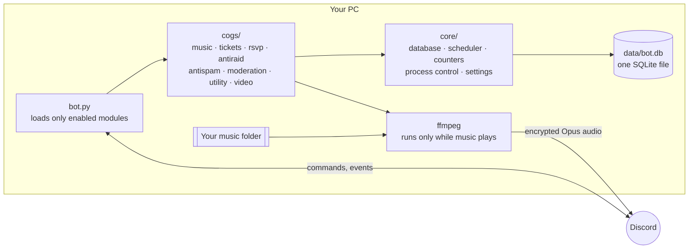

<div align="center">

# 🏠 Den

**One Discord bot for music, tickets, events, anti-raid, anti-spam and moderation.<br>
Small enough to run on an old PC. Yours, on your own machine.**


[What it does](#what-it-does) ·
[How little it uses](#how-little-it-uses) ·
[Setup](#setup) ·
[Permissions explained](#permissions-and-access-explained) ·
[Commands](COMMANDS.md) ·
[How it works](#how-it-works) ·
[Troubleshooting](#troubleshooting)

</div>

---

| | Measured |
|---|---|
| 🧠 RAM while online | **56 MB** |
| 💤 CPU while idle | **0.00 %** (too small to measure) |
| 🎵 ffmpeg CPU while playing music | **0.5 – 5 %** of one core |
| 💾 Disk for the whole install | **29 MB** |
| 📦 Python packages you install | **1** |

Measured on Windows 11 with a Ryzen 7 6800H. See [How little it uses](#how-little-it-uses) for the
method and for what to expect on a slower CPU.

No Docker. No database server. No Java audio server. No cloud. No subscription.

## Why it exists

Most servers end up running four or five separate bots: one for music, one for tickets, one for
moderation, one for events. Each one is somebody else's server holding your data, and the good
features are often behind a subscription. Self-hosted alternatives usually want Docker, a
database server and a separate Java audio server.

Den is the opposite trade: one small program, on a PC you already own.

- **Local first.** Your music plays from your own folders. Settings, tickets, warnings and
  events live in a single SQLite file in `data/`. Nothing is sent anywhere except Discord.
- **Pay for what you use.** Every feature is a module. Switch one off in `config.toml` and its
  code is never even loaded.
- **Survives a bad connection.** It reconnects by itself with growing delays, resumes the music
  queue after a restart, and sends reminders late rather than never.
- **Two clicks to run.** `setup.bat`, then `start.bat`.

## Project status

**Prototype.** Honest state of each part:

| Part | State |
|---|---|
| Offline test suite | ✅ 109 checks pass |
| Connecting, reconnecting, slash-command registration | ✅ Working live |
| Music from local files into a voice channel | ✅ Working live (heard in a real call) |
| Queue resumes after a restart | ✅ Working live |
| Everything else in music (seek, volume, playlists, YouTube) | 🧪 Passes offline tests, not yet tried live |
| Events, moderation, video | 🧪 Loaded live, commands not yet exercised |
| Tickets, anti-spam, anti-raid, utility | 🧪 Pass offline tests, not yet loaded live |
| Linux scripts | ❔ Written, never run |

Expect bugs in anything marked 🧪 or ❔.

## What it does

| | Module | What you get |
|---|---|---|
| 🎵 | **music** | Plays your own files (mp3, flac, ogg, opus, m4a, wav, mp4). Queue, skip, loop, shuffle, volume, seek, saved playlists. Picks up where it left off after a restart. Optional YouTube. |
| 🎬 | **video** | Plays the audio of local video files. Cuts short clips and posts them as files. |
| 🛡️ | **antispam** | Catches message floods, repeats, mass mentions, emoji and caps walls, invite links and unwanted links. Escalates: warn → timeout → kick → ban. |
| 🚨 | **antiraid** | Spots join floods and locks the server by itself. Filters brand-new accounts. Verify button. `/panic` and `/unlock`. |
| 🎫 | **tickets** | Button panel, private channel per ticket, claim and close, transcripts saved to your disk as HTML or text. |
| 📅 | **rsvp** | Events with Going / Maybe / Can't go buttons, capacity with a waitlist, reminders, auto-close. |
| 🔨 | **moderation** | warn, timeout, kick, ban, unban, purge, slowmode, and a per-member history. |
| 🧰 | **utility** | Welcome and leave messages, auto-role, reaction roles, delete/edit logs. |
| ⏰ | **reminders** | `/remind in 2h stretch`: the bot DMs you when it is time. Daily or weekly repeat. Survives restarts; reminders that came due while the bot was off are sent when it is back, marked as late. |
| 📊 | **polls** | Discord's own polls: up to 10 options, 1 hour to 32 days, single or multiple choice. Discord counts the votes and posts the result, even while the bot is off. |
| 📂 | **media folders** | `/library setup`: the bot owner picks music and video folders in Discord. No config editing. |
| 🍿 | **watch** | `/watch start`: watch a local video together **in the browser, in sync**, with no screen sharing. Pause or seek once and it happens for everyone. Full quality, no upload limit. |
| 📈 | **usage** | The bot's status line always shows its live RAM and CPU. `/status` shows bot, ffmpeg, whole-PC CPU/RAM and GPU. |

## How it works



- **`bot.py`** reads `config.toml`, opens the database, and imports only the modules you switched
  on. It asks Discord for only the event types those modules need.
- **`cogs/`** holds one file per feature. They never talk to each other's tables.
- **`core/`** is the shared plumbing: one database thread that batches writes, one timer that
  sleeps until the next reminder is due, in-memory counters that expire on their own, and a
  wrapper that starts and cleanly kills helper programs.
- **ffmpeg** turns a music file into Opus audio and is only running while something plays. If the
  file is already Opus it is copied through without re-encoding.
- **Nothing leaves your PC** except what Discord needs: command replies and the audio stream.

## What "local" means here

The bot program, your music files and all saved data stay on your PC. Two things are unavoidable:

1. **Discord itself is an online service.** The bot needs internet to talk to it, and music is
   uploaded from your PC to Discord's voice servers while it plays (roughly 100 kbit/s).
2. **The bot only works while it is running.** When the PC is off or asleep, buttons, tickets,
   anti-spam and reminders do nothing. Reminders that came due while it was off are sent late.

## Limits you should know about

- **Video in voice channels is not possible.** Discord gives bots no way to send video or
  screen-share. The only workaround is automating a normal user account, which breaks Discord's
  Terms of Service and gets accounts banned. This bot does not do it. Use
  [watch parties](#watch-parties) instead: everyone watches in their browser, in sync.
- **YouTube downloading breaks YouTube's Terms of Service.** It is off by default
  (`music.youtube = false`). If you turn it on, keep it to personal use in a private server. It
  also stops working whenever YouTube changes something, until you update yt-dlp.
- **Lockdown is a blunt tool.** It removes talking permissions from @everyone. Channels that
  explicitly allow @everyone through their own settings stay open.
- **Message delete/edit logs** only cover the most recent messages (`bot.message_cache`, 500 by
  default). That is the price of low memory use.

## Permissions and access, explained

Discord shows a long list of switches and checkboxes during setup. This section covers each one
the bot asks for: what it allows, which feature needs it, and what happens if you leave it off.
Nothing here is optional by accident. If you don't want a feature, switch the module off in
`config.toml` and the bot stops asking for what that module needs.

### Privileged Gateway Intents (Developer Portal > Bot)

Intents decide which **events** Discord sends to the bot. Two of them are "privileged", which
means you have to switch them on yourself on the **Bot** page. For a bot in fewer than 100
servers this is just a toggle, with no review or approval.

| Intent | Turn on? | What it lets the bot see | Needed by | If it is off |
|---|---|---|---|---|
| **Server Members Intent** | Yes, if you use anti-raid or utility | Members joining, leaving and changing roles, and the member list | **Anti-raid** (spots join waves and brand-new accounts), **Utility** (welcome/farewell messages, auto-role on join) | Those two modules are skipped at startup. Everything else still runs. |
| **Message Content Intent** | Yes, if you use anti-spam, anti-raid, tickets or utility | The **text** of messages in channels the bot can view | **Anti-spam** (repeated text, links, invite links), **Anti-raid** (new members posting invites or mass mentions), **Tickets** (saving the conversation as a transcript), **Utility** (logging deleted and edited messages) | Those modules are skipped at startup. Slash commands, music, events and moderation commands do **not** need it. |
| Presence Intent | **No** | Online status and activities | Nothing | Leave it off. |

The bot works out which intents it needs from the modules you turned on in `[modules]`. If one
is off in the portal, it doesn't crash: the startup log names the missing intent and the modules
that were skipped, and everything else starts normally. To fix it, switch the intent on, click
**Save Changes**, and restart the bot.

The bot also uses these normal intents, which need no switch: **Guilds** (servers, channels and
roles), **Voice States** (music: who is in which voice channel, leaving when everyone has gone),
**Guild Messages** (that a message was sent; its text needs Message Content) and **Guild
Reactions** (reaction roles).

### Server permissions (the invite link)

The invite link in [Setup](#1-create-the-bot-in-discord) asks for exactly these, and never
**Administrator**:

| Permission | Why the bot needs it | Used by | If you untick it |
|---|---|---|---|
| View Channels | See the channels it should work in | Everything | The bot sees nothing |
| Send Messages | Replies, event cards, logs, ticket messages | Everything | No replies in chat |
| Embed Links | The cards for `/status`, `/help`, events and logs | Core, events, logs | Cards don't show |
| Attach Files | Post video clips and ticket transcripts | Video, tickets | `/video clip` and transcripts fail |
| Read Message History | Read a ticket's messages to save the transcript, find messages to purge | Tickets, moderation | Transcripts are empty, `/purge` fails |
| Add Reactions | Put the emoji under a reaction-role message | Utility | Reaction roles must be set up by hand |
| Manage Messages | Delete spam, `/purge` | Anti-spam, moderation | Spam stays up, `/purge` fails |
| Manage Channels | Create and close ticket channels, `/slowmode` | Tickets, moderation | Tickets cannot open |
| Manage Roles | Give auto-roles, reaction roles and the verify role; lock @everyone during a raid; set who can see a ticket | Utility, anti-raid, tickets | Roles aren't given, lockdown only affects new joins |
| Kick Members | `/kick`, and anti-spam/anti-raid if their action is `kick` | Moderation, anti-spam, anti-raid | Those actions fail with a clear message |
| Ban Members | `/ban`, `/unban`, and anti-raid if its action is `ban` | Moderation, anti-raid | Same |
| Moderate Members | `/timeout`, and the anti-spam timeout | Moderation, anti-spam | Same |
| Connect, Speak | Join a voice channel and play audio | Music, video | No music |
| Send Polls | Post Discord's built-in polls | Polls | `/poll create` says which permission is missing |

**Role order matters too.** Discord only lets the bot manage roles and members **below its own
role**. In Server Settings > Roles, drag the bot's role above the roles it hands out and above
the members it should be able to moderate.

### Who can use which commands

| Group | Who | Examples |
|---|---|---|
| Everyone | Any member | `/play`, `/queue`, `/help`, `/remind`, `/poll create`, event buttons, ticket button |
| Staff | **Manage Server** permission, or the role set with `/config staff-role` | `/status`, `/rescan_library`, `/antispam`, ticket management, ending anyone's poll |
| Moderators | The matching Discord permission (Kick, Ban, Moderate Members, Manage Messages) | `/kick`, `/ban`, `/timeout`, `/purge` |
| **Bot owner only** | The account that owns the app in the Developer Portal. Server admins are **not** enough. | `/library` (media folders), `/restart`, `/shutdown`, `/sync` |

`/library` is limited to the owner because it browses folders on the PC that runs the bot.
A server admin may be someone other than the person whose computer this is.

### What the bot can access on your computer

| What | Access |
|---|---|
| The music and video folders you choose (`/library setup` or `config.toml`) | **Read only.** It lists and plays files and never changes, moves or deletes them. |
| Its own `data/` folder | Read and write: database, logs, ticket transcripts, temporary clips, YouTube cache. |
| `.env` | Read once at startup to get the token. |
| Other programs | Starts **ffmpeg** to decode audio and make clips, and **yt-dlp** only if YouTube is switched on. |
| Network | Discord only. YouTube too, only if `music.youtube = true`. No telemetry, no other servers. |
| Web server (watch parties) | Only **while a watch party runs**, on port 8765. It answers only the party's secret link and serves only that one video. Closed again when the last party ends. |

## Setup

### 1. Create the bot in Discord

1. Open <https://discord.com/developers/applications> and click **New Application**.
2. Go to **Bot**. Click **Reset Token**, then **Copy**. This is your token. Keep it private.
3. On the same page, under **Privileged Gateway Intents**, switch on **Server Members Intent**
   and **Message Content Intent**, then click **Save Changes**. Anti-raid, anti-spam, tickets and
   utility need them; music, events and moderation do not. See
   [why each one is needed](#privileged-gateway-intents-developer-portal--bot). Leave
   **Presence Intent** off.
4. On **General Information**, copy the **Application ID**, put it in this link in place of
   `YOUR_APP_ID`, open the link and choose your server:

```
https://discord.com/oauth2/authorize?client_id=YOUR_APP_ID&scope=bot+applications.commands&permissions=564049736756310
```

That link asks for: View Channels, Send Messages, Embed Links, Attach Files, Read Message History,
Add Reactions, Manage Messages, Manage Channels, Manage Roles, Kick Members, Ban Members,
Moderate Members, Connect, Speak, Send Polls. [What each one is for](#server-permissions-the-invite-link).

5. In your server, drag the bot's role **above** the roles it should manage (auto-role,
   reaction roles, verification role) and above the members it should be able to moderate.

### 2. Install

**Windows:** double-click `setup.bat`.
**Linux:** `chmod +x setup.sh && ./setup.sh`

Setup creates a private Python environment in `.venv`, installs the dependency, creates `.env`
and runs a self-test. It needs Python 3.11 or newer. ffmpeg is only needed for music and video.

### 3. Add your token

Open `.env` in a text editor and paste the token:

```
DISCORD_TOKEN=your-token-here
```

### 4. Edit `config.toml`

`config.toml` is created from `config.example.toml` the first time the bot (or setup) runs. It is
your personal copy and is never uploaded to GitHub.

- `dev_guild_id`: your server's ID, so slash commands appear instantly.
- Music and video folders: easiest is to pick them in Discord with `/library setup` (step 6).
  You can also list them under `[music] library_dirs` / `[video] library_dirs`.
- `[modules]`: switch off anything you do not want.

### 5. Start

**Windows:** double-click `start.bat`.
**Linux:** `./start.sh`

The start script restarts the bot if it crashes. Stop it with Ctrl+C, or `/shutdown` in Discord.

### 6. First steps in Discord

**Choose your media folders.** As the bot owner, type `/library setup`. A private panel opens:

- **➕ Add a music folder**: pick Music, Downloads, Desktop and so on from the list, or choose
  **Type a folder path…** for any other folder, such as `D:\Songs`.
- **➕ Add a video folder**: the same for video files.
- **➖ Remove a folder**: stop using one. Your files are not touched.
- **🔄 Rescan**: press it after copying new files into a folder.

The panel shows how many files each folder holds and which file types count. `/library add`
does the same in one line, and its folder box suggests folders as you type.

```
/library setup                        choose music and video folders
/config log-channel #mod-log          where logs go
/config staff-role @Moderator         who counts as staff
/ticket category-add Support @Moderator
/ticket panel                         posts the ticket button
/antiraid verify-setup @Member        optional verify button
/welcome set #welcome
/play                                 start typing a song title
```

## Watch parties

Watch a video from the bot's PC together, without anyone sharing their screen.

1. `/watch start` and pick a video. The bot posts a message with a link button.
2. Everyone opens the link in a browser (phone or PC) and presses **Join**.
3. Use the player's normal buttons. When anyone pauses, seeks or plays, everyone follows within
   about a second. The page shows how many people are watching.
4. `/watch end` closes it. It also closes by itself after 30 minutes with nobody watching.

**How it works:** while a party runs, the bot starts a small web server on this PC (part of
discord.py's own dependencies, nothing extra to install). Browsers download the video straight
from it at full quality. Files browsers cannot play are converted first: `.mkv` with H.264 is only
repackaged (seconds), and other formats are re-encoded (takes a while; the page shows progress).

**Who can open the link:**

| Viewer is… | What to do |
|---|---|
| On the same Wi-Fi as the bot's PC | Nothing. The link works. The first time, Windows asks whether Python may use the network: allow **Private networks**. |
| Anywhere else | Either install [cloudflared](https://developers.cloudflare.com/cloudflare-one/connections/connect-networks/downloads/) (`winget install Cloudflare.cloudflared`) and set `tunnel = "cloudflared"` under `[watch]`, or set `public_url` to your own port forward or tunnel. |

The Wi-Fi link is plain `http://`, so some browsers (Brave, or Chrome with "Always use secure
connections") show a "not secure" page first: press **Continue to site**. The tunnel link is
`https://` and shows no warning.

With `tunnel = "cloudflared"` the bot opens a free, temporary Cloudflare link while a party runs
and closes it afterwards. No Cloudflare account is needed. Every viewer streams the video from
your PC, so your **upload speed** limits how many people can watch smoothly. A 1080p video needs
about 5–8 Mbit/s per viewer.

**Safety:** each party gets a random, unguessable link (128 bits). The server answers nothing
else: no folder listing, no other files, no index page. It stops listening when no party is
running. Anyone who has the link can watch while the party runs, so share it only where you want.

## Commands

**Full reference with every option: [COMMANDS.md](COMMANDS.md).** In Discord, `/help` shows the same
list for the modules you have switched on, and `/help module:` explains one area in detail.
`/help` is always available, even with every optional module off.

| Area | Commands |
|---|---|
| Core | `/ping` `/status` `/help` `/config log-channel` `/config staff-role` `/config show` `/sync` `/restart` `/shutdown` |
| Music | `/play` `/playall` `/youtube` (if enabled) `/pause` `/resume` `/skip` `/stop` `/leave` `/volume` `/seek` `/loop` `/shuffle` `/remove` `/clear` `/nowplaying` `/queue` `/rescan_library` `/playlist save\|load\|list\|delete` |
| Video | `/video play` `/video clip` `/video rescan` |
| Anti-spam | `/antispam status` `/antispam ignore-role` `/antispam ignore-channel` |
| Anti-raid | `/panic` `/unlock` `/antiraid status` `/antiraid verify-setup` `/antiraid verify-off` |
| Tickets | `/ticket panel` `/ticket category-add` `/ticket category-remove` `/ticket close` `/ticket claim` `/ticket add` `/ticket remove` |
| Events | `/event create` `/event cancel` `/event list` `/event attendees` |
| Moderation | `/warn` `/history` `/clearwarnings` `/timeout` `/untimeout` `/kick` `/ban` `/unban` `/purge` `/slowmode` |
| Utility | `/welcome set\|leave\|off` `/autorole` `/reactionrole add\|remove\|list` |

After adding or changing a command, run `tools/gen_commands.py` to rebuild `COMMANDS.md`.

## How little it uses

Measured on Windows 11, Python 3.12, Ryzen 7 6800H, with the bot online in one small server.
CPU figures are a share of **one** core.

**See it live on your own machine:**

- The bot's status line in the member list always shows `RAM .. MB · CPU ..%`, updated every
  minute (bot plus its ffmpeg helpers). Turn it off with `show_usage = false` under `[bot]`.
- `/status` (staff) shows four lines: the **bot** (RAM, CPU), its **helpers** (ffmpeg, yt-dlp),
  the **whole PC** (CPU and RAM) and the **GPU** (NVIDIA cards, read with `nvidia-smi`).
  CPU there is a share of the whole processor, like Task Manager.
- **GPU:** the bot uses none. Audio is decoded by ffmpeg on the CPU, so the GPU line is only
  there to show what the rest of the PC is doing.
- No extra package: readings come straight from Windows (or `/proc` on Linux).

| What | Measured |
|---|---|
| Bot online, 4 modules loaded (music, video, events, moderation) | **55.5 MB** RAM |
| All 8 modules loaded, before connecting | 55 MB RAM |
| Windows launcher stub that comes with a Python virtual environment | +4 MB |
| Idle CPU, averaged over 60 seconds | **0.000 %** (below what Windows can measure) |
| ffmpeg playing an Opus file, passed through untouched | 0.5 % CPU, 20 MB RAM |
| ffmpeg playing an mp3, converted to Opus | 1.6 % CPU, 22 MB RAM |
| ffmpeg playing a FLAC, converted to Opus | 4.7 % CPU, 24 MB RAM |
| Whole install on disk (Python environment + code) | 29 MB |
| The bot's own code | about 4,200 lines in 22 files |

So with music playing, the bot and ffmpeg together use roughly **80 MB of RAM**.

**On an old PC:** this test CPU is several times faster per core than an old dual-core
laptop chip. Expect the music figures to be roughly 3 to 6 times higher there, which still
leaves Opus passthrough at a few percent and mp3 playback around 5 to 10 % of one core. RAM does
not change with CPU speed. These slower-CPU figures are an estimate, not a measurement.

Not measured yet: all eight modules online together in a busy server, YouTube downloads
(a separate yt-dlp process, roughly 50-70 MB for a few seconds), and `/video clip` (a full core
while it encodes).

### Where the savings come from

| Choice | What it avoids |
|---|---|
| Only the Discord intents the enabled modules need | Receiving and parsing events nobody uses |
| No member-list download at startup; only people in voice are cached | Memory that grows with server size |
| 500-message cache instead of the default 1,000 | RAM, at the cost of shorter delete/edit logs |
| Modules that are off are never imported | Paying for features you do not use |
| SQLite on one worker thread, writes batched into one transaction | A database server, and disk thrashing on an HDD |
| One timer that sleeps until the next job is due | Polling loops that wake the CPU every second |
| Anti-spam counters in memory that expire on their own | A database read on every message |
| ffmpeg writes Opus directly; Opus files are copied, not re-encoded | Python handling raw audio; most of the encoding work |
| yt-dlp runs as a short-lived separate process | About 50 MB of permanently loaded library |
| No Java audio server, no Redis, no Docker | Several hundred MB of always-on services |

## Testing

No token needed for these:

| Command | Expected |
|---|---|
| `.venv\Scripts\python.exe tests\test_core.py` | `All 32 checks passed.` |
| `.venv\Scripts\python.exe tests\test_startup.py` | `Startup checks passed.` |
| `.venv\Scripts\python.exe tests\test_music.py` | `All 30 music checks passed.` (`--youtube` adds 4 network checks) |
| `.venv\Scripts\python.exe tests\test_modules.py` | `All 80 module checks passed.` |
| `.venv\Scripts\python.exe tests\test_watch.py` | `All 38 watch checks passed.` (real web server, two viewers in sync) |
| `.venv\Scripts\python.exe bot.py --check` | Report with `Modules failed  none` |

On Linux use `.venv/bin/python`. Live checks once the bot is online:

| Try | Expected |
|---|---|
| `/ping`, `/status` | Latency; RAM, uptime and module list |
| Unplug the network for a minute | Log shows `Connection resumed after a drop.` |
| Start with no network | `Cannot reach Discord ... Retrying in 2s`, 4s, 8s ... up to 300s |
| `/play` while in a voice channel | Music starts; `/seek 0:30`, `/volume 50`, `/skip` work |
| `/restart` during music with someone in voice | Bot returns and continues the queue |
| Post 7 messages quickly from a non-staff account | Messages deleted, warning, then timeout |
| `/panic`, then `/unlock` | @everyone cannot talk, then can again |
| Ticket button, then Close | Private channel; transcript in `data/transcripts/` and the log channel |
| `/event create title:Test when:in 20m reminder_minutes:15` | Buttons work; reminder after 5 minutes |

## Keeping your secrets safe

| File | Contains | Uploaded to GitHub? |
|---|---|---|
| `.env` | Your bot token | **Never** (listed in `.gitignore`) |
| `config.toml` | Your server ID and folder paths | **Never** |
| `data/` | Database (including folders picked with `/library`), logs, transcripts, cached audio | **Never** |
| `config.example.toml`, `.env.example` | Blank templates | Yes |

- Anyone with the bot token controls your bot. Never paste it in chat, screenshots or issues.
- If a token is ever exposed, open the Developer Portal > Bot > **Reset Token** and put the new
  one in `.env`. The old token stops working immediately.
- With `voice_debug = true`, `data/logs/bot.log` contains short-lived voice session keys. Do not
  share that log; switch the setting off again when you are done.

## Folder layout

```
den/
  bot.py              entry point: config, database, module loading, reconnect, exit codes
  config.example.toml template for all settings, commented
  config.toml         your copy, created on first start (not uploaded)
  config.lite.toml    phone / very weak machine preset
  .env                your token (created by setup, never share it)
  requirements.txt / requirements-lite.txt
  setup.bat / setup.sh      one-time install
  start.bat / start.sh      run with auto-restart
  core/
    config.py     TOML + .env loading
    db.py         SQLite on one worker thread, automatic write batching
    settings.py   per-server settings, cached in memory
    scheduler.py  persistent timers (reminders, auto-close, auto-unlock)
    ttl.py        expiring in-memory counters for anti-spam / anti-raid
    proc.py       ffmpeg / yt-dlp process control with timeouts and tree kill
    checks.py     permission checks and user-facing error messages
    modlog.py     log-channel writer and role-hierarchy check
    sysinfo.py    RAM and disk readings
    log.py        console + rotating log file
  cogs/           one file per module (system.py is always loaded; library.py loads with music)
  web/            watch.html, the watch-party player page
  tools/          gen_commands.py (rebuilds COMMANDS.md), audio-check.ps1 (Windows sound levels)
  tests/          offline tests, no token needed
  COMMANDS.md     every slash command, generated from the code
  data/           bot.db, logs/, cache/, transcripts/ (created automatically)
```

Database tables: `guild_settings`, `jobs` (core); `library`, `playlists`, `playlist_tracks`,
`queue_state`, `cache_index` (music); `spam_log`; `raid_log`; `ticket_categories`, `tickets`;
`events`, `rsvps`; `mod_actions`; `reaction_roles`. Each module creates its own tables on first load.

## Troubleshooting

| Problem | Fix |
|---|---|
| `DISCORD_TOKEN is not set` | Copy `.env.example` to `.env` and paste the token after `=`. |
| `Discord rejected the token` | The token is wrong or was reset. Developer Portal > Bot > Reset Token. |
| `intents are not switched on` | Developer Portal > Bot > Privileged Gateway Intents: enable the ones named, save. |
| Slash commands do not appear | Set `dev_guild_id` and restart, or wait up to an hour. The invite link must include `applications.commands`. Try `/sync`. |
| `Another copy of the bot is already running` | Close the other window, or end `python.exe` in Task Manager. |
| `Python was not found` | Install Python 3.11+ from python.org and tick "Add python.exe to PATH". |
| `ffmpeg not found` / music is silent | Windows: `winget install Gyan.FFmpeg`, reopen the window. Linux: `sudo apt install ffmpeg`. |
| Bot joins voice and says "Now playing" but nobody hears anything | Run `/status` and read the **Voice** line. `E2EE ... NOT ready` means the `davey` library is too new for discord.py: run `.venv\Scripts\python.exe -m pip install "davey<0.2"` and restart. If it says `ready`, the problem is on the listener's side: run `tools\audio-check.ps1` to see whether Discord is producing sound in Windows. |
| `/play` finds nothing | Run `/library setup` (bot owner) and add your music folder, or press **Rescan** after adding files. Check the file type is listed in `music.extensions`. |
| `/library` is missing or says "only the bot owner" | Only the account that owns the app in the Developer Portal can use it. Server admins see it but cannot run it. |
| "Skipping ...: ffmpeg could not read it" | The file is damaged or not really audio. |
| YouTube lookups fail | Update yt-dlp: `pip install -U yt-dlp`. Newer versions may need `ytdlp_args = ["--js-runtimes", "node"]`. |
| "Discord refused that action" | Drag the bot's role higher in Server Settings > Roles and check its permissions. |
| Auto-role / reaction role / verify does nothing | Same: the bot's role must sit above the role it hands out. |
| Ticket button says the channel cannot be created | The bot needs Manage Channels and Manage Roles. |
| A module is under "Failed to load" in `/status` | Read `data/logs/bot.log`. The other modules keep running. |
| Bot keeps restarting | Read the end of `data/logs/bot.log`. The restart delay grows to 5 minutes. |
| "The disk is full" | Free space. The failed action was not saved; the database is not damaged. |

## Adding a module

1. Create `cogs/hello.py`:

```python
import discord
from discord import app_commands
from discord.ext import commands

SCHEMA = "CREATE TABLE IF NOT EXISTS hello_count (guild_id INTEGER PRIMARY KEY, n INTEGER NOT NULL)"


class Hello(commands.Cog):
    def __init__(self, bot: commands.Bot):
        self.bot = bot

    async def cog_load(self) -> None:
        await self.bot.db.script(SCHEMA)              # your own tables

    @app_commands.command(description="Say hello and count it.")
    @app_commands.guild_only()
    async def hello(self, interaction: discord.Interaction) -> None:
        await self.bot.db.execute(
            "INSERT INTO hello_count VALUES (?, 1) ON CONFLICT (guild_id) DO UPDATE SET n = n + 1",
            (interaction.guild_id,))
        row = await self.bot.db.fetchone("SELECT n FROM hello_count WHERE guild_id = ?", (interaction.guild_id,))
        greeting = self.bot.cfg.get("hello.greeting", "Hello")
        await interaction.response.send_message(f"{greeting}! That is hello number {row['n']}.")


async def setup(bot: commands.Bot) -> None:
    await bot.add_cog(Hello(bot))
```

2. Add `"hello"` to `KNOWN_MODULES` in `core/config.py`.
3. Add `"hello": (),` to `MODULE_INTENTS` in `bot.py`. List gateway intents only if the module
   listens to events (for example `("guild_messages", "message_content")` to read messages).
4. Add `hello = true` under `[modules]` in `config.toml`, and optionally a `[hello]` section.
5. Restart. The new command is uploaded automatically.

What the bot gives every module:

| Object | Use |
|---|---|
| `bot.db` | `execute`, `executemany`, `fetchone`, `fetchall`, `script`, and `write_later` for fire-and-forget writes |
| `bot.settings` | Per-server values: `await bot.settings.get(guild_id, "key", default)` / `.set(...)` |
| `bot.scheduler` | `register("kind", handler)` in `cog_load`, then `await add(when, "kind", {...}, ref="x")` |
| `bot.cfg` | `bot.cfg.get("section.key", default)` from `config.toml` |
| `core.checks.UserError` | Raise it with a message to show the user a clean error |
| `core.checks.guarded` | Wrap button handlers so their errors are shown too |
| `core.modlog.send_log` | Write to the server's log channel |
| `core.proc.run` | Run a helper program with a timeout, without blocking the bot |

Rules that keep it light: never block the event loop (use `asyncio.to_thread` for file work),
no polling loops (use `bot.scheduler` or `loop.call_later`), and keep per-user state in
`core.ttl` structures so it expires on its own.
