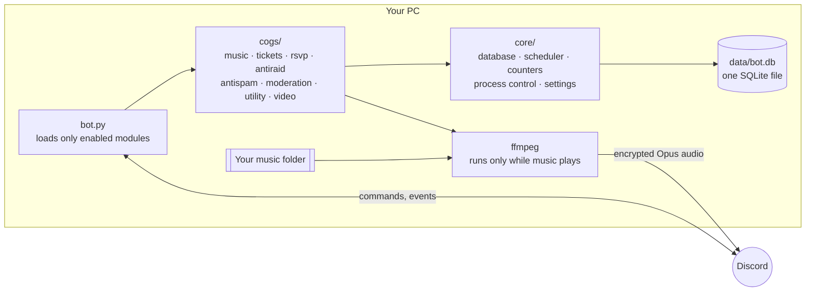

<div align="center">

# 🥔 Potato Bot

**One Discord bot for music, tickets, events, anti-raid, anti-spam and moderation.<br>
Small enough to run on an old PC. Yours, on your own machine.**


[What it does](#what-it-does) ·
[How little it uses](#how-little-it-uses) ·
[Setup](#setup) ·
[Commands](COMMANDS.md) ·
[How it works](#how-it-works) ·
[Troubleshooting](#troubleshooting)

</div>

---

| | Measured |
|---|---|
| 🧠 RAM while online | **56 MB** |
| 💤 CPU while idle | **0.00 %** (too small to measure) |
| 🎵 ffmpeg CPU while playing music | **0.5 – 5 %** of one core |
| 💾 Disk for the whole install | **29 MB** |
| 📦 Python packages you install | **1** |

Measured on Windows 11 with a Ryzen 7 6800H. See [How little it uses](#how-little-it-uses) for the
method and for what to expect on a slower CPU.

No Docker. No database server. No Java audio server. No cloud. No subscription.

## Why it exists

Most servers end up running four or five separate bots: one for music, one for tickets, one for
moderation, one for events. Each one is somebody else's server holding your data, and the good
features are often behind a subscription. Self-hosted alternatives usually want Docker, a
database server and a separate Java audio server.

Potato Bot is the opposite trade: one small program, on a PC you already own.

- **Local first.** Your music plays from your own folders. Settings, tickets, warnings and
  events live in a single SQLite file in `data/`. Nothing is sent anywhere except Discord.
- **Pay for what you use.** Every feature is a module. Switch one off in `config.toml` and its
  code is never even loaded.
- **Survives a bad connection.** It reconnects by itself with growing delays, resumes the music
  queue after a restart, and sends reminders late rather than never.
- **Two clicks to run.** `setup.bat`, then `start.bat`.

## Project status

**Prototype.** Honest state of each part:

| Part | State |
|---|---|
| Offline test suite | ✅ 109 checks pass |
| Connecting, reconnecting, slash-command registration | ✅ Working live |
| Music from local files into a voice channel | ✅ Working live (heard in a real call) |
| Queue resumes after a restart | ✅ Working live |
| Everything else in music (seek, volume, playlists, YouTube) | 🧪 Passes offline tests, not yet tried live |
| Events, moderation, video | 🧪 Loaded live, commands not yet exercised |
| Tickets, anti-spam, anti-raid, utility | 🧪 Pass offline tests, not yet loaded live |
| Linux scripts, Android/Termux steps | ❔ Written, never run |

Expect bugs in anything marked 🧪 or ❔.

## What it does

| | Module | What you get |
|---|---|---|
| 🎵 | **music** | Plays your own files (mp3, flac, ogg, opus, m4a, wav, mp4). Queue, skip, loop, shuffle, volume, seek, saved playlists. Picks up where it left off after a restart. Optional YouTube. |
| 🎬 | **video** | Plays the audio of local video files. Cuts short clips and posts them as files. |
| 🛡️ | **antispam** | Catches message floods, repeats, mass mentions, emoji and caps walls, invite links and unwanted links. Escalates: warn → timeout → kick → ban. |
| 🚨 | **antiraid** | Spots join floods and locks the server by itself. Filters brand-new accounts. Verify button. `/panic` and `/unlock`. |
| 🎫 | **tickets** | Button panel, private channel per ticket, claim and close, transcripts saved to your disk as HTML or text. |
| 📅 | **rsvp** | Events with Going / Maybe / Can't go buttons, capacity with a waitlist, reminders, auto-close. |
| 🔨 | **moderation** | warn, timeout, kick, ban, unban, purge, slowmode, and a per-member history. |
| 🧰 | **utility** | Welcome and leave messages, auto-role, reaction roles, delete/edit logs. |

## How it works



- **`bot.py`** reads `config.toml`, opens the database, and imports only the modules you switched
  on. It asks Discord for only the event types those modules need.
- **`cogs/`** holds one file per feature. They never talk to each other's tables.
- **`core/`** is the shared plumbing: one database thread that batches writes, one timer that
  sleeps until the next reminder is due, in-memory counters that expire on their own, and a
  wrapper that starts and cleanly kills helper programs.
- **ffmpeg** turns a music file into Opus audio and is only running while something plays. If the
  file is already Opus it is copied through without re-encoding.
- **Nothing leaves your PC** except what Discord needs: command replies and the audio stream.

## What "local" means here

The bot program, your music files and all saved data stay on your PC. Two things are unavoidable:

1. **Discord itself is an online service.** The bot needs internet to talk to it, and music is
   uploaded from your PC to Discord's voice servers while it plays (roughly 100 kbit/s).
2. **The bot only works while it is running.** When the PC is off or asleep, buttons, tickets,
   anti-spam and reminders do nothing. Reminders that came due while it was off are sent late.

## Limits you should know about

- **Video in voice channels is not possible.** Discord gives bots no way to send video or
  screen-share. The only workaround is automating a normal user account, which breaks Discord's
  Terms of Service and gets accounts banned. This bot does not do it.
- **YouTube downloading breaks YouTube's Terms of Service.** It is off by default
  (`music.youtube = false`). If you turn it on, keep it to personal use in a private server. It
  also stops working whenever YouTube changes something, until you update yt-dlp.
- **Lockdown is a blunt tool.** It removes talking permissions from @everyone. Channels that
  explicitly allow @everyone through their own settings stay open.
- **Message delete/edit logs** only cover the most recent messages (`bot.message_cache`, 500 by
  default). That is the price of low memory use.

## Setup

### 1. Create the bot in Discord

1. Open <https://discord.com/developers/applications> and click **New Application**.
2. Go to **Bot**. Click **Reset Token**, then **Copy**. This is your token. Keep it private.
3. On the same page, under **Privileged Gateway Intents**, switch on **Server Members Intent**
   and **Message Content Intent**, then save. (Anti-raid, anti-spam, tickets and utility need
   them. The bot names exactly which ones it needs at startup.)
4. On **General Information**, copy the **Application ID**, put it in this link in place of
   `YOUR_APP_ID`, open the link and choose your server:

```
https://discord.com/oauth2/authorize?client_id=YOUR_APP_ID&scope=bot+applications.commands&permissions=1099783334998
```

That link asks for: View Channels, Send Messages, Embed Links, Attach Files, Read Message History,
Add Reactions, Manage Messages, Manage Channels, Manage Roles, Kick Members, Ban Members,
Moderate Members, Connect, Speak.

5. In your server, drag the bot's role **above** the roles it should manage (auto-role,
   reaction roles, verification role) and above the members it should be able to moderate.

### 2. Install

**Windows:** double-click `setup.bat`.
**Linux:** `chmod +x setup.sh && ./setup.sh`

Setup creates a private Python environment in `.venv`, installs the dependency, creates `.env`
and runs a self-test. It needs Python 3.11 or newer. ffmpeg is only needed for music and video.

### 3. Add your token

Open `.env` in a text editor and paste the token:

```
DISCORD_TOKEN=your-token-here
```

### 4. Edit `config.toml`

`config.toml` is created from `config.example.toml` the first time the bot (or setup) runs. It is
your personal copy and is never uploaded to GitHub.

- `dev_guild_id`: your server's ID, so slash commands appear instantly.
- `[music] library_dirs`: your music folders, for example `["C:/Users/you/Music"]`.
- `[modules]`: switch off anything you do not want.

### 5. Start

**Windows:** double-click `start.bat`.
**Linux:** `./start.sh`

The start script restarts the bot if it crashes. Stop it with Ctrl+C, or `/shutdown` in Discord.

### 6. First steps in Discord

```
/config log-channel #mod-log          where logs go
/config staff-role @Moderator         who counts as staff
/ticket category-add Support @Moderator
/ticket panel                         posts the ticket button
/antiraid verify-setup @Member        optional verify button
/welcome set #welcome
/play                                 start typing a song title
```

## Commands

**Full reference with every option: [COMMANDS.md](COMMANDS.md).** In Discord, `/help` shows the same
list for the modules you have switched on, and `/help module:` explains one area in detail.
`/help` is always available, even with every optional module off.

| Area | Commands |
|---|---|
| Core | `/ping` `/status` `/help` `/config log-channel` `/config staff-role` `/config show` `/sync` `/restart` `/shutdown` |
| Music | `/play` `/playall` `/youtube` (if enabled) `/pause` `/resume` `/skip` `/stop` `/leave` `/volume` `/seek` `/loop` `/shuffle` `/remove` `/clear` `/nowplaying` `/queue` `/rescan_library` `/playlist save\|load\|list\|delete` |
| Video | `/video play` `/video clip` `/video rescan` |
| Anti-spam | `/antispam status` `/antispam ignore-role` `/antispam ignore-channel` |
| Anti-raid | `/panic` `/unlock` `/antiraid status` `/antiraid verify-setup` `/antiraid verify-off` |
| Tickets | `/ticket panel` `/ticket category-add` `/ticket category-remove` `/ticket close` `/ticket claim` `/ticket add` `/ticket remove` |
| Events | `/event create` `/event cancel` `/event list` `/event attendees` |
| Moderation | `/warn` `/history` `/clearwarnings` `/timeout` `/untimeout` `/kick` `/ban` `/unban` `/purge` `/slowmode` |
| Utility | `/welcome set\|leave\|off` `/autorole` `/reactionrole add\|remove\|list` |

After adding or changing a command, run `tools/gen_commands.py` to rebuild `COMMANDS.md`.

## How little it uses

Measured on Windows 11, Python 3.12, Ryzen 7 6800H, with the bot online in one small server.
CPU figures are a share of **one** core. `/status` shows the live RAM number on your machine.

| What | Measured |
|---|---|
| Bot online, 4 modules loaded (music, video, events, moderation) | **55.5 MB** RAM |
| All 8 modules loaded, before connecting | 55 MB RAM |
| Windows launcher stub that comes with a Python virtual environment | +4 MB |
| Idle CPU, averaged over 60 seconds | **0.000 %** (below what Windows can measure) |
| ffmpeg playing an Opus file, passed through untouched | 0.5 % CPU, 20 MB RAM |
| ffmpeg playing an mp3, converted to Opus | 1.6 % CPU, 22 MB RAM |
| ffmpeg playing a FLAC, converted to Opus | 4.7 % CPU, 24 MB RAM |
| Whole install on disk (Python environment + code) | 29 MB |
| The bot's own code | about 4,200 lines in 22 files |

So with music playing, the bot and ffmpeg together use roughly **80 MB of RAM**.

**On an actual potato:** this test CPU is several times faster per core than an old dual-core
laptop chip. Expect the music figures to be roughly 3 to 6 times higher there, which still
leaves Opus passthrough at a few percent and mp3 playback around 5 to 10 % of one core. RAM does
not change with CPU speed. These slower-CPU figures are an estimate, not a measurement.

Not measured yet: all eight modules online together in a busy server, YouTube downloads
(a separate yt-dlp process, roughly 50-70 MB for a few seconds), and `/video clip` (a full core
while it encodes).

### Where the savings come from

| Choice | What it avoids |
|---|---|
| Only the Discord intents the enabled modules need | Receiving and parsing events nobody uses |
| No member-list download at startup; only people in voice are cached | Memory that grows with server size |
| 500-message cache instead of the default 1,000 | RAM, at the cost of shorter delete/edit logs |
| Modules that are off are never imported | Paying for features you do not use |
| SQLite on one worker thread, writes batched into one transaction | A database server, and disk thrashing on an HDD |
| One timer that sleeps until the next job is due | Polling loops that wake the CPU every second |
| Anti-spam counters in memory that expire on their own | A database read on every message |
| ffmpeg writes Opus directly; Opus files are copied, not re-encoded | Python handling raw audio; most of the encoding work |
| yt-dlp runs as a short-lived separate process | About 50 MB of permanently loaded library |
| No Java audio server, no Redis, no Docker | Several hundred MB of always-on services |

## Testing

No token needed for these:

| Command | Expected |
|---|---|
| `.venv\Scripts\python.exe tests\test_core.py` | `All 32 checks passed.` |
| `.venv\Scripts\python.exe tests\test_startup.py` | `Startup checks passed.` |
| `.venv\Scripts\python.exe tests\test_music.py` | `All 30 music checks passed.` (`--youtube` adds 4 network checks) |
| `.venv\Scripts\python.exe tests\test_modules.py` | `All 44 module checks passed.` |
| `.venv\Scripts\python.exe bot.py --check` | Report with `Modules failed  none` |

On Linux use `.venv/bin/python`. Live checks once the bot is online:

| Try | Expected |
|---|---|
| `/ping`, `/status` | Latency; RAM, uptime and module list |
| Unplug the network for a minute | Log shows `Connection resumed after a drop.` |
| Start with no network | `Cannot reach Discord ... Retrying in 2s`, 4s, 8s ... up to 300s |
| `/play` while in a voice channel | Music starts; `/seek 0:30`, `/volume 50`, `/skip` work |
| `/restart` during music with someone in voice | Bot returns and continues the queue |
| Post 7 messages quickly from a non-staff account | Messages deleted, warning, then timeout |
| `/panic`, then `/unlock` | @everyone cannot talk, then can again |
| Ticket button, then Close | Private channel; transcript in `data/transcripts/` and the log channel |
| `/event create title:Test when:in 20m reminder_minutes:15` | Buttons work; reminder after 5 minutes |

## Running on Android (Termux)

Untested by the author on a real phone; these are the expected steps.

```
pkg update && pkg upgrade
pkg install python git
termux-setup-storage
git clone <your repository URL> potato-bot
cd potato-bot
REQUIREMENTS=requirements-lite.txt ./setup.sh
nano .env                                  # paste the token
termux-wake-lock                           # keeps the CPU awake while the screen is off
./start.sh --config config.lite.toml
```

Battery and background steps, or Android will stop the bot:

1. Android Settings > Apps > Termux > Battery > **Unrestricted**.
2. Run `termux-wake-lock` each time before starting (a notification shows it is held).
3. Keep the phone on a charger. Install Termux from F-Droid, not the Play Store build.
4. Android 12 and newer kill background processes of apps like Termux. If the bot dies after a
   while, disable the "phantom process killer" with a computer:
   `adb shell "settings put global settings_enable_monitor_phantom_procs false"`

What does not work on a phone:

- **Music and video.** Lite mode switches them off. The voice libraries have to be compiled on
  the phone (`pkg install rust clang libsodium ffmpeg`, then the normal `requirements.txt`),
  which takes a long time and may fail. Audio encoding also drains the battery quickly.
- **Reliable 24/7 uptime.** Phones switch networks and sleep. The bot reconnects on its own,
  but expect gaps.
- **`/video clip`.** Far too slow on phone CPUs.

## Keeping your secrets safe

| File | Contains | Uploaded to GitHub? |
|---|---|---|
| `.env` | Your bot token | **Never** (listed in `.gitignore`) |
| `config.toml` | Your server ID and folder paths | **Never** |
| `data/` | Database, logs, transcripts, cached audio | **Never** |
| `config.example.toml`, `.env.example` | Blank templates | Yes |

- Anyone with the bot token controls your bot. Never paste it in chat, screenshots or issues.
- If a token is ever exposed, open the Developer Portal > Bot > **Reset Token** and put the new
  one in `.env`. The old token stops working immediately.
- With `voice_debug = true`, `data/logs/bot.log` contains short-lived voice session keys. Do not
  share that log; switch the setting off again when you are done.

## Folder layout

```
potato-bot/
  bot.py              entry point: config, database, module loading, reconnect, exit codes
  config.example.toml template for all settings, commented
  config.toml         your copy, created on first start (not uploaded)
  config.lite.toml    phone / very weak machine preset
  .env                your token (created by setup, never share it)
  requirements.txt / requirements-lite.txt
  setup.bat / setup.sh      one-time install
  start.bat / start.sh      run with auto-restart
  core/
    config.py     TOML + .env loading
    db.py         SQLite on one worker thread, automatic write batching
    settings.py   per-server settings, cached in memory
    scheduler.py  persistent timers (reminders, auto-close, auto-unlock)
    ttl.py        expiring in-memory counters for anti-spam / anti-raid
    proc.py       ffmpeg / yt-dlp process control with timeouts and tree kill
    checks.py     permission checks and user-facing error messages
    modlog.py     log-channel writer and role-hierarchy check
    sysinfo.py    RAM and disk readings
    log.py        console + rotating log file
  cogs/           one file per module (system.py is always loaded)
  tools/          gen_commands.py (rebuilds COMMANDS.md), audio-check.ps1 (Windows sound levels)
  tests/          offline tests, no token needed
  COMMANDS.md     every slash command, generated from the code
  data/           bot.db, logs/, cache/, transcripts/ (created automatically)
```

Database tables: `guild_settings`, `jobs` (core); `library`, `playlists`, `playlist_tracks`,
`queue_state`, `cache_index` (music); `spam_log`; `raid_log`; `ticket_categories`, `tickets`;
`events`, `rsvps`; `mod_actions`; `reaction_roles`. Each module creates its own tables on first load.

## Troubleshooting

| Problem | Fix |
|---|---|
| `DISCORD_TOKEN is not set` | Copy `.env.example` to `.env` and paste the token after `=`. |
| `Discord rejected the token` | The token is wrong or was reset. Developer Portal > Bot > Reset Token. |
| `intents are not switched on` | Developer Portal > Bot > Privileged Gateway Intents: enable the ones named, save. |
| Slash commands do not appear | Set `dev_guild_id` and restart, or wait up to an hour. The invite link must include `applications.commands`. Try `/sync`. |
| `Another copy of the bot is already running` | Close the other window, or end `python.exe` in Task Manager. |
| `Python was not found` | Install Python 3.11+ from python.org and tick "Add python.exe to PATH". |
| `ffmpeg not found` / music is silent | Windows: `winget install Gyan.FFmpeg`, reopen the window. Linux: `sudo apt install ffmpeg`. |
| Bot joins voice and says "Now playing" but nobody hears anything | Run `/status` and read the **Voice** line. `E2EE ... NOT ready` means the `davey` library is too new for discord.py: run `.venv\Scripts\python.exe -m pip install "davey<0.2"` and restart. If it says `ready`, the problem is on the listener's side: run `tools\audio-check.ps1` to see whether Discord is producing sound in Windows. |
| `/play` finds nothing | Set `music.library_dirs` in `config.toml`, restart or run `/rescan_library`. |
| "Skipping ...: ffmpeg could not read it" | The file is damaged or not really audio. |
| YouTube lookups fail | Update yt-dlp: `pip install -U yt-dlp`. Newer versions may need `ytdlp_args = ["--js-runtimes", "node"]`. |
| "Discord refused that action" | Drag the bot's role higher in Server Settings > Roles and check its permissions. |
| Auto-role / reaction role / verify does nothing | Same: the bot's role must sit above the role it hands out. |
| Ticket button says the channel cannot be created | The bot needs Manage Channels and Manage Roles. |
| A module is under "Failed to load" in `/status` | Read `data/logs/bot.log`. The other modules keep running. |
| Bot keeps restarting | Read the end of `data/logs/bot.log`. The restart delay grows to 5 minutes. |
| "The disk is full" | Free space. The failed action was not saved; the database is not damaged. |

## Adding a module

1. Create `cogs/hello.py`:

```python
import discord
from discord import app_commands
from discord.ext import commands

SCHEMA = "CREATE TABLE IF NOT EXISTS hello_count (guild_id INTEGER PRIMARY KEY, n INTEGER NOT NULL)"


class Hello(commands.Cog):
    def __init__(self, bot: commands.Bot):
        self.bot = bot

    async def cog_load(self) -> None:
        await self.bot.db.script(SCHEMA)              # your own tables

    @app_commands.command(description="Say hello and count it.")
    @app_commands.guild_only()
    async def hello(self, interaction: discord.Interaction) -> None:
        await self.bot.db.execute(
            "INSERT INTO hello_count VALUES (?, 1) ON CONFLICT (guild_id) DO UPDATE SET n = n + 1",
            (interaction.guild_id,))
        row = await self.bot.db.fetchone("SELECT n FROM hello_count WHERE guild_id = ?", (interaction.guild_id,))
        greeting = self.bot.cfg.get("hello.greeting", "Hello")
        await interaction.response.send_message(f"{greeting}! That is hello number {row['n']}.")


async def setup(bot: commands.Bot) -> None:
    await bot.add_cog(Hello(bot))
```

2. Add `"hello"` to `KNOWN_MODULES` in `core/config.py`.
3. Add `"hello": (),` to `MODULE_INTENTS` in `bot.py`. List gateway intents only if the module
   listens to events (for example `("guild_messages", "message_content")` to read messages).
4. Add `hello = true` under `[modules]` in `config.toml`, and optionally a `[hello]` section.
5. Restart. The new command is uploaded automatically.

What the bot gives every module:

| Object | Use |
|---|---|
| `bot.db` | `execute`, `executemany`, `fetchone`, `fetchall`, `script`, and `write_later` for fire-and-forget writes |
| `bot.settings` | Per-server values: `await bot.settings.get(guild_id, "key", default)` / `.set(...)` |
| `bot.scheduler` | `register("kind", handler)` in `cog_load`, then `await add(when, "kind", {...}, ref="x")` |
| `bot.cfg` | `bot.cfg.get("section.key", default)` from `config.toml` |
| `core.checks.UserError` | Raise it with a message to show the user a clean error |
| `core.checks.guarded` | Wrap button handlers so their errors are shown too |
| `core.modlog.send_log` | Write to the server's log channel |
| `core.proc.run` | Run a helper program with a timeout, without blocking the bot |

Rules that keep it light: never block the event loop (use `asyncio.to_thread` for file work),
no polling loops (use `bot.scheduler` or `loop.call_later`), and keep per-user state in
`core.ttl` structures so it expires on its own.
